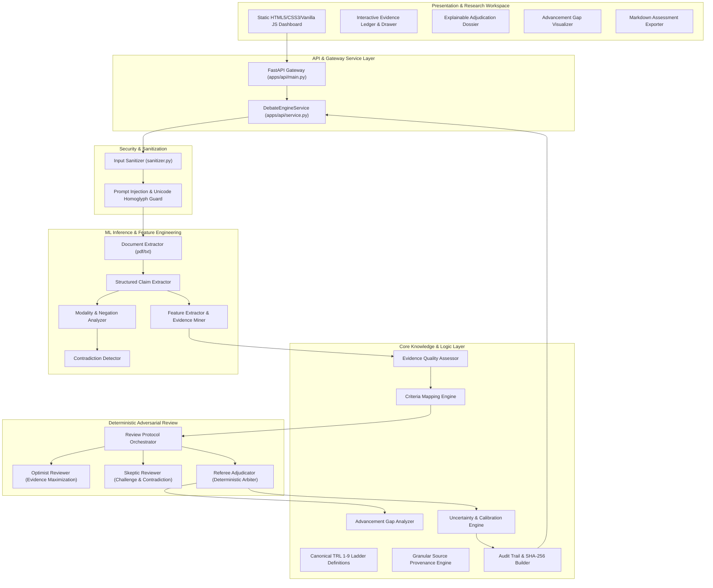
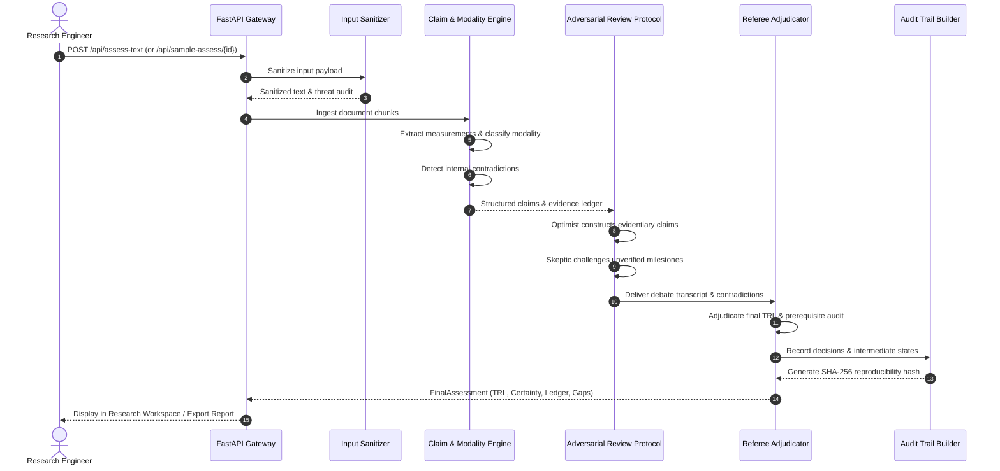

# ARGUS Architecture & Data Models Specification
**Version:** 2.0.0-argus  
**System:** ARGUS Research Intelligence Engine  
**Runtime Requirement:** Air-Gapped Python 3.10+ Environment  

---

## 1. System Architecture Overview

ARGUS is architected as a modular, high-reliability technical evaluation platform. All modules are decoupled with explicit Pydantic v2 data models, ensuring strict typing, runtime validation, and complete testability.



---

## 2. Component Inventory

| Layer | Module Path | Purpose |
|---|---|---|
| **Presentation** | `apps/api/src/api/static/index.html` | High-density technical research workspace; renders multi-agent debate, evidence ledger with source provenance drawer, uncertainty card, and gap analysis. |
| **API Gateway** | `apps/api/src/api/main.py` | FastAPI application exposing assessment endpoints (`/api/assess-text`, `/api/sample-assess/{id}`, `/api/sample-assess/{id}/report`). |
| **Service Layer** | `apps/api/src/api/service.py` | Orchestration layer connecting HTTP requests to the ML inference and multi-agent pipeline. |
| **Core Models** | `packages/core/src/trl_core/models.py` | Pydantic v2 data models defining the entire domain model. |
| **TRL Definitions** | `packages/core/src/trl_core/trl_definitions.py` | Official NASA/DoD/ISO TRL 1–9 definitions and checklist criteria. |
| **Sanitizer** | `packages/core/src/trl_core/sanitizer.py` | Security filter protecting against prompt injections, role-play hijacks, and Unicode obfuscation. |
| **Claim Extraction** | `packages/ml_inference/src/ml_inference/claim_extractor.py` | Extracts quantitative measurements, tolerances, and milestone statements. |
| **Modality Analysis** | `packages/ml_inference/src/ml_inference/modality.py` | Grammatical analysis of completed vs negated vs planned vs hypothetical claims. |
| **Contradictions** | `packages/core/src/trl_core/contradiction.py` | Detects internal document tensions between abstract claims and limitation disclosures. |
| **Criteria Mapping** | `packages/core/src/trl_core/criteria_mapper.py` | Maps evidence to TRL 1–9 criteria (DIRECTLY_SATISFIED, PARTIALLY_SUPPORTED, SATISFIED_INFERRED, CONTRADICTORY, MISSING). |
| **Multi-Agent Review**| `packages/agent_orchestration/src/agent_orchestration/` | Deterministic protocol running Optimist argumentation, Skeptic challenge, and Referee adjudication. |
| **Gap Analysis** | `packages/core/src/trl_core/gap_analysis.py` | Generates concrete engineering recommendations for progression to TRL N+1. |
| **Uncertainty Engine**| `packages/core/src/trl_core/uncertainty.py` | Computes decoupled extraction confidence, criteria coverage, conflict penalty, and composite certainty. |
| **Audit Trail** | `packages/core/src/trl_core/audit.py` | Records execution stages and computes deterministic SHA-256 verification hashes. |

---

## 3. Data Flow Architecture



---

## 4. Canonical Pydantic v2 Data Schemas

### 4.1 TechnicalClaim & QuantitativeMeasurement
```python
class QuantitativeMeasurement(BaseModel):
    metric: str
    value: float
    unit: str
    raw_text: str
    tolerance: Optional[str] = None

class TechnicalClaim(BaseModel):
    id: str
    document_id: str
    chunk_id: str
    text: str
    candidate_trl: int
    achievement_category: str
    measurements: List[QuantitativeMeasurement] = Field(default_factory=list)
    validation_environment: ValidationEnvironment = ValidationEnvironment.UNSPECIFIED
    modality: ModalityType = ModalityType.COMPLETED
    temporal_status: TemporalStatus = TemporalStatus.HISTORICAL_OR_CURRENT
    evidence_type: EvidenceType = EvidenceType.EMPIRICAL
    verbatim_quote: str
    char_offset_start: int
    char_offset_end: int
    section_name: Optional[str] = None
    confidence: float = 0.80
```

### 4.2 CriteriaMapping & ContradictionItem
```python
class CriteriaMapping(BaseModel):
    criterion_id: str
    trl_level: int
    criterion_description: str
    status: CriteriaStatus  # DIRECTLY_SATISFIED | PARTIALLY_SUPPORTED | SATISFIED_INFERRED | CONTRADICTORY | MISSING
    supporting_evidence_ids: List[str] = Field(default_factory=list)
    rationale: str

class ContradictionItem(BaseModel):
    id: str
    claim_id_a: str
    claim_id_b: str
    explanation: str
    severity: str  # HIGH | MEDIUM
    resolved_status: str  # UNRESOLVED | RESOLVED_OPTIMIST_ACCEPTED | RESOLVED_SKEPTIC_UPHELD
    resolution_rationale: Optional[str] = None
```

### 4.3 UncertaintyProfile & AdvancementGapReport
```python
class UncertaintyProfile(BaseModel):
    extraction_confidence: float = Field(ge=0.0, le=1.0)
    criteria_coverage: float = Field(ge=0.0, le=1.0)
    conflict_penalty: float = Field(ge=0.0, le=1.0)
    composite_certainty: float = Field(ge=0.0, le=1.0)
    calibration_status: str
    notes: List[str] = Field(default_factory=list)

class AdvancementGapReport(BaseModel):
    current_trl: int
    target_next_trl: int
    required_environment: str
    missing_criteria: List[str] = Field(default_factory=list)
    recommended_activities: List[str] = Field(default_factory=list)
    blockers: List[str] = Field(default_factory=list)
```

### 4.4 AuditTrail & FinalAssessment
```python
class AuditRecord(BaseModel):
    stage: str
    rule_id: str
    inputs: Dict[str, Any]
    outcome: str
    explanation: str

class AuditTrail(BaseModel):
    document_id: str
    adjudicated_trl: int
    records: List[AuditRecord] = Field(default_factory=list)
    methodology_version: str = "2.0.0-argus"
    reproducibility_hash: str

class FinalAssessment(BaseModel):
    predicted_trl: int = Field(ge=1, le=9)
    confidence: float = Field(ge=0.0, le=1.0)
    justification: str
    satisfied_criteria: List[str]
    implied_prerequisites_audit: List[ImpliedPrerequisiteAudit]
    missing_criteria: List[str]
    contradictions: List[Dict[str, Any]]
    recommendations: List[str]
    supporting_evidence: List[EvidenceItem]
    agent_assessments: Dict[str, AgentAssessment]
    debate_transcript: List[DebateMessage]
    evidence_ledger: Optional[Dict[str, Any]] = None
    criteria_mappings: List[CriteriaMapping] = Field(default_factory=list)
    uncertainty_profile: Optional[UncertaintyProfile] = None
    audit_trail: Optional[AuditTrail] = None
    gap_report: Optional[AdvancementGapReport] = None
    methodology_version: str = "2.0.0-argus"
```

---

## 5. Air-Gap Deployment & Verification

ARGUS operates strictly offline with zero network connectivity:
1. **Zero External API Calls:** No calls to OpenAI, Anthropic, Hugging Face Hub, or external embedding servers.
2. **Zero Remote Weight Downloads:** All models, tokenizer heuristics, and regex automata are local.
3. **Standalone Submission Archive:** The `submission/` directory contains an autonomous, self-contained distribution package runnable via:
   ```bash
   python submission/run_inference.py -i <input_document.txt> -o <output_assessment.json>
   ```
4. **Determinism Verification:** Executing the evaluation twice on identical hardware with the same input document produces bitwise identical JSON responses with matching SHA-256 reproducibility hashes.
